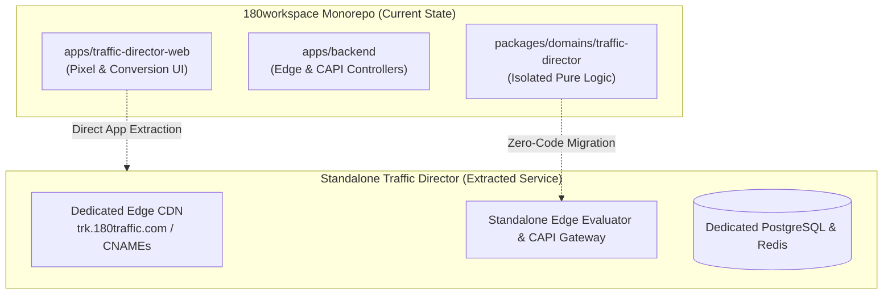
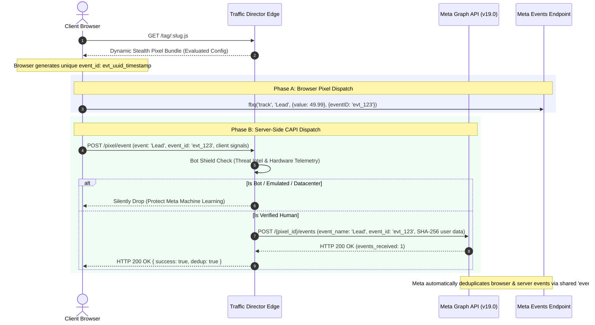

# Architectural Master Plan: Dedicated Tracking Domain & Universal Meta Pixel & CAPI Manager

**System:** 180 Traffic Director (`@workspace/traffic-director`)  
**Role:** Principal Distributed Systems Architect  
**Status:** Ready for Implementation  
**Target Delivery:** Production-Grade / Standalone Extraction Ready  

---

## 1. Executive Vision & Monorepo Decoupling Architecture

### 1.1 Strategic Objective
Transform 180 Traffic Director from a high-performance cloaking and conditional routing engine into a comprehensive **Enterprise Traffic & Conversion Infrastructure Platform**.

Key capabilities:
1. **Dedicated Tracking Domain & First-Party CNAME Delegation**: Complete isolation from `180workspace.com`, enabling first-party cookie preservation (bypassing Safari ITP and ad-blockers) and zero domain reputation contamination.
2. **Universal Meta Pixel & CAPI Manager**: Single-snippet remote pixel deployment, multi-pixel redundancy (Agency Master + Client + Backup), automated conversion event capture, and server-side Conversions API (CAPI) deduplication.
3. **Bot-Gated Conversion Optimization**: Preventing Meta Ads review bots, datacenter scrapers, and commercial ad spy tools from polluting Meta Ads machine learning datasets.
4. **Clean Standalone Extractability**: 100% decoupling of domain logic into `packages/domains/traffic-director` so the entire engine can be spun out into an independent repository/microservice at any time without code refactoring.

---

## 2. System Architecture & Monorepo Separation Blueprint



### 2.1 Decoupling Guardrails (For Future Extraction)
To guarantee Traffic Director can be extracted into its own standalone repository without friction:
1. **Zero Monorepo App Coupling**: `packages/domains/traffic-director` must never import from `apps/frontend`, `apps/admin-web`, or sibling domain packages.
2. **Dedicated Environment Configuration**: All tracking CDN and evaluation endpoints must consume `TRAFFIC_DIRECTOR_CDN_URL` and `TRAFFIC_DIRECTOR_API_URL` instead of generic `NEXT_PUBLIC_APP_URL`.
3. **Company Tenancy Scoping**: Every database query and cache key strictly isolates data by `companyId`.
4. **Self-Contained DB Migration Pack**: The Prisma models for Pixel Management will live cleanly within the Traffic Director domain scope.

---

## 3. Dedicated Tracking Domain & CDN Pipeline

### 3.1 First-Party CNAME vs. Shared Platform Domain

| Vector | Shared Platform Domain (`app.180workspace.com`) | Dedicated Platform Domain (`trk.180td.com`) | First-Party Client CNAME (`analytics.client.com`) |
| :--- | :--- | :--- | :--- |
| **Ad Blocker Resilience** | Low (flagged by EasyList) | Medium (independent rotation) | **Maximum (1st-party host, immune to generic lists)** |
| **Safari ITP Lifespan** | Capped at 1-7 days | Capped at 7 days | **Full 1st-party cookie retention (up to 13 months)** |
| **Reputation Blast Radius**| High (affects main app auth/billing) | Isolated to tracking infra | **Isolated to client brand** |
| **Future Extraction Cost** | Breaking change for all client tags | **Zero breaking change** | **Zero breaking change** |

### 3.2 DNS & Edge Routing Architecture
1. **Apex & Subdomain Routing**:
   - Default Platform CDN: `https://trk.180traffic.com/tag/:slug.js`
   - Custom Agency CNAME: `CNAME trk.agency.com -> edge.180traffic.com`
2. **Edge SSL & Host Resolution**:
   - Handled via SNI-based automatic SSL termination.
   - Host header inspection resolves the target `TrafficLink` or `PixelIntegration` via in-memory radix tree.
3. **Fail-Open Policy**:
   - If the tracking engine encounters a timeout or internal Redis degradation, it silently returns an HTTP 200 with an empty JavaScript no-op, ensuring client websites **never** experience page render blocking or console exceptions.

---

## 4. Universal Meta Pixel & CAPI Engine Specification

### 4.1 Database Architecture (`packages/db`)

```prisma
model TrafficPixelConfig {
  id              String             @id @default(uuid())
  linkId          String             @unique
  companyId       String
  masterPixelId   String             // Primary Meta Pixel ID (e.g. "123456789012345")
  backupPixelIds  String[]           @default([]) // Secondary / Agency audit pixels
  capiTokenEnc    String?            // AES-256-GCM Encrypted Meta Access Token
  testEventCode   String?            // Meta Events Manager Debug Code (e.g. "TEST12345")
  enableCapi      Boolean            @default(true)
  fireOnBots      Boolean            @default(false) // Filter bot hits from pixel firing
  trackPageViews  Boolean            @default(true)
  trackOutbound   Boolean            @default(true)
  events          TrafficPixelEvent[]
  createdAt       DateTime           @default(now())
  updatedAt       DateTime           @updatedAt

  link            TrafficLink        @relation(fields: [linkId], references: [id], onDelete: Cascade)
  company         Company            @relation(fields: [companyId], references: [id], onDelete: Cascade)

  @@index([linkId])
  @@index([companyId])
}

model TrafficPixelEvent {
  id              String             @id @default(uuid())
  configId        String
  eventName       String             // Lead, Purchase, AddToCart, ViewContent, Custom
  triggerType     String             // form_submit, click, element_visible, url_match, custom_js
  selector        String?            // CSS Selector (e.g. "#lead-form", ".btn-checkout")
  urlPattern      String?            // Regex or string match (e.g. "/thank-you")
  eventValueKey   String?            // Data key or input name for monetary value
  currency        String             @default("USD")
  isEnabled       Boolean            @default(true)
  createdAt       DateTime           @default(now())
  updatedAt       DateTime           @updatedAt

  config          TrafficPixelConfig @relation(fields: [configId], references: [id], onDelete: Cascade)

  @@index([configId])
}

model TrafficPixelLog {
  id              String             @id @default(uuid())
  linkId          String
  pixelId         String
  eventId         String             // Shared deduplication ID
  eventName       String
  deliverySource  String             // browser, server_capi, hybrid_dedup
  browserFired    Boolean            @default(false)
  capiFired       Boolean            @default(false)
  capiStatus      String?            // success, failed, rate_limited
  capiLatencyMs   Int?
  isBotFiltered   Boolean            @default(false)
  ipAddress       String?
  userAgent       String?
  fbp             String?
  fbc             String?
  timestamp       DateTime           @default(now())

  link            TrafficLink        @relation(fields: [linkId], references: [id], onDelete: Cascade)

  @@index([linkId, timestamp])
  @@index([eventId])
}
```

### 4.2 Security Architecture (Zero-Secrets & Token Encryption)
In strict compliance with `.agents/rules/security-and-secrets.md`:
- Meta CAPI Access Tokens are **never stored in plaintext**.
- Encryption standard: **AES-256-GCM** with unique 96-bit initialization vectors (IV) and 128-bit authentication tags.
- The encryption key is sourced dynamically from `TRAFFIC_DIRECTOR_SECRET_KEY` (or AWS KMS / GCP Secret Manager in production).
- Tokens are **never emitted** to browser bundles or client-side JavaScript tags. CAPI requests are executed strictly server-to-server.

### 4.3 Browser + CAPI Deduplication Lifecycle



---

## 5. Step-by-Step Implementation Roadmap

### Phase 1: Core Domain Engine & Cryptographic Vault
- **Module**: `packages/domains/traffic-director/src/services/pixel.service.ts`
- **Responsibilities**:
  - CRUD for multi-pixel configurations per smart link.
  - AES-256-GCM cryptographic encryption/decryption routines.
  - User identity normalization & SHA-256 hashing (email, phone, IP, user agent, `_fbp`, `_fbc`).
- **Deliverable**: Unit test suite verifying cryptographic integrity and multi-tenant isolation.

### Phase 2: Dynamic JS Tag Generator & Bot Shield Interceptor
- **Module**: `packages/domains/traffic-director/src/evaluator/client-shield-generator.ts`
- **Responsibilities**:
  - Injecting Meta base `fbq` script dynamically based on database configuration.
  - Multi-pixel broadcast: Iterating through `masterPixelId` and `backupPixelIds`.
  - DOM Event Listeners: Auto-detecting form submissions, button clicks, and single-page app (SPA) history changes.
  - Bot Shield Gating: Restricting pixel execution if client hardware fails touchpoint, GPU renderer, or webdriver probes.
- **Deliverable**: Dynamic tag generation test suite benchmarking execution under `< 2.5ms`.

### Phase 3: Edge Routing Controller & Dedicated Domain Gateway
- **Module**: `apps/backend/src/api/v1/traffic-director/`
- **Responsibilities**:
  - `PublicRoutingController.handleDynamicTag`: High-throughput tag serving with Redis edge caching.
  - `PublicRoutingController.handlePixelEvent`: Ingesting browser telemetry and conversion pings.
  - Dedicated domain host header matching (supporting custom CNAMEs).
- **Deliverable**: Integration test suite simulating high-concurrency requests and CNAME hostname mapping.

### Phase 4: Server-Side Meta CAPI Dispatcher & Queue Worker
- **Module**: `packages/domains/traffic-director/src/services/capi.service.ts`
- **Responsibilities**:
  - Non-blocking asynchronous event batching.
  - Meta Graph API v19.0 endpoint dispatcher: `https://graph.facebook.com/v19.0/{pixel_id}/events`.
  - Automatic retry with exponential backoff on Meta 429/500 responses.
  - Logging to `TrafficPixelLog` for real-time dashboard streaming.
- **Deliverable**: CAPI simulation test suite mocking Meta API responses and deduplication IDs.

### Phase 5: UI/UX Management Portal in `apps/traffic-director-web`
- **Module**: `apps/traffic-director-web/app/(platform)/(traffic-director-app)/traffic-director/links/[linkId]/`
- **Responsibilities**:
  - **Pixel Configuration Tab**: Manage Master, Client, and Backup Meta Pixel IDs.
  - **Event Rules Canvas**: Visual trigger builder for Lead, Purchase, AddToCart, and custom events.
  - **Live Conversion Stream**: Terminal-style log inspector showing Browser vs. CAPI delivery and deduplication status.
  - **Adherence to Design System**: Built with `@workspace/ui`, Shadcn UI primitives, Tailwind dark glassmorphism, and subscription locking via `useSubscription()`.
- **Deliverable**: End-to-end user experience audit with zero hydration or a11y errors.

---

## 6. Simulation & Automated Test Suites (The 6-Suite Verification Harness)

To guarantee production-readiness without regression, the following 6 automated test suites will be created under `packages/domains/traffic-director/scripts/tests/`:

### Test Suite 24: Pixel Configuration & Cryptographic Vault Security
- **File**: `test_24_pixel_configuration_and_encryption.ts`
- **Simulations**:
  - Verifies multi-pixel assignment (1 Master + up to 5 Backup Pixels).
  - Validates AES-256-GCM encryption: Verifies cipher text is non-deterministic and authentication tags detect tampering.
  - Confirms raw access tokens never leak into JSON payloads or public responses.

### Test Suite 25: Dynamic Stealth Script Tag Generation
- **File**: `test_25_stealth_pixel_tag_generation.ts`
- **Simulations**:
  - Benchmarks dynamic JavaScript compilation (target < 3ms).
  - Tests minification and syntax validity across ES6 and legacy browsers.
  - Verifies dynamic injection of multiple pixel IDs (`fbq('init', id1); fbq('init', id2);`).

### Test Suite 26: Bot-Gated Pixel Firing Matrix
- **File**: `test_26_bot_gated_pixel_filtering.ts`
- **Simulations**:
  - **Simulation A (Facebook Review Crawler)**: User-Agent `facebookexternalhit/1.1` -> Tag silently renders clean safe page without firing conversion events.
  - **Simulation B (Headless Chrome / Puppeteer)**: `navigator.webdriver = true` -> Event dispatch aborted.
  - **Simulation C (Datacenter IP)**: AWS/DigitalOcean IP -> Ingested as bot, CAPI dispatch suppressed.
  - **Simulation D (Real Residential Human Mobile)**: iPhone, AT&T IP, TouchPoints > 0 -> Fires both Browser Pixel and CAPI.

### Test Suite 27: Meta Conversions API (CAPI) & Deduplication Engine
- **File**: `test_27_capi_event_deduplication.ts`
- **Simulations**:
  - Generates deterministic `event_id` and verifies identical propagation across browser and server payloads.
  - Verifies SHA-256 normalization (email lowercased and trimmed, international phone numbers formatted to E.164).
  - Validates payload formatting conforming strictly to Meta Graph API v19.0 schemas.

### Test Suite 28: Client-Side Browser Simulation (Forms, SPAs & Ad-Blocker)
- **File**: `test_28_browser_client_event_simulation.ts`
- **Simulations**:
  - Simulates DOM form submission (`#lead-form`) triggering automated `Lead` event dispatch.
  - Simulates SPA route navigation (History API `pushState`) triggering automated `PageView`.
  - Simulates ad-blocker environment (blocked `connect.facebook.net`): Verifies server-side CAPI takes over seamlessly so **zero conversions are lost**.

### Test Suite 29: End-to-End Dedicated Domain & CNAME Resolution Pipeline
- **File**: `test_29_dedicated_domain_e2e_pipeline.ts`
- **Simulations**:
  - Evaluates request through dedicated CDN domain (`trk.180traffic.com`).
  - Evaluates request through custom client CNAME (`analytics.clientbrand.com`).
  - Benchmarks overall edge round-trip latency (P99 < 15ms).
  - Confirms zero dependency on the main `180workspace` frontend, certifying complete extraction readiness.

---

## 7. Operational Readiness & Launch Checklist

1. **Prerequisites & Environment**:
   - `TRAFFIC_DIRECTOR_SECRET_KEY`: High-entropy 32-byte hexadecimal key for token encryption.
   - `TRAFFIC_DIRECTOR_CDN_URL`: Dedicated public CDN hostname for script delivery.
2. **Backward Compatibility**:
   - Existing smart links and cloaking redirects continue functioning with zero schema conflicts.
   - Links without pixel configurations bypass pixel evaluation logic with zero CPU overhead.
3. **Rollback Strategy**:
   - Feature flagged per tenant. If disabled, edge servers instantly revert to standard conditional redirect mode.
